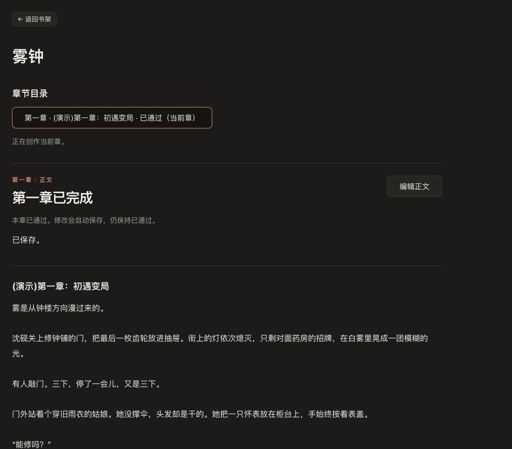

<h1 align="center">
  
</h1>

<p align="center">
  
  
  
  
  <a href="./LICENSE"></a>
</p>

<p align="center">
  <a href="#current-status">✦ Introduction</a> ·
  <a href="#quick-start">→ Quick start</a> ·
  <a href="#docs">⌘ Docs</a> ·
  <a href="./README.md">中文</a>
</p>

**From a single idea to a finished chapter.** Enter a story idea or import text from TXT, Markdown (`.md`), Word (`.docx`), or PDF documents. AI helps develop directions, outlines, settings and chapter prose; you edit the content, review its direction and decide when to continue.



<a id="current-status"></a>

## ✦ Introduction

**agent4novel is a local AI-assisted writing tool for Chinese web novels, used in your browser.** The local minimum viable product (MVP) has been delivered; development continues.

<a id="features"></a>

## ◆ Features

- **Ideas and documents:** Start with an idea or document and develop creative directions, an outline, setting, chapter plans and prose.
- **Review and continuation:** Review, edit and rewrite chapter by chapter, with history retained and an explicit choice to start the next chapter.
- **Writing configuration:** Configure style, genre, payoff, models and generation parameters, with optional Prompt and Skill guidance files.
- **Bad examples:** Mark prose selections and add notes, preserving the original text and version for later review.
- **Local storage:** Keep works, artifact versions, configuration and uploaded files on your computer, with restart recovery and backup support.

<a id="quick-start"></a>

## → Quick start

### Docker (recommended)

```bash
git clone https://github.com/12bitsD/agent4novel.git
cd agent4novel
docker compose up --build -d --wait
```

Open **[localhost:8787](http://localhost:8787)**. Stop with `docker compose stop`.

<details>
<summary>Run from source</summary>

Requires **Node.js 24.19.0 and pnpm 12.5.1**, for macOS and Linux:

```bash
git clone https://github.com/12bitsD/agent4novel.git
cd agent4novel
pnpm install --frozen-lockfile
pnpm dev
```

Leave the terminal running and open **[localhost:5173](http://localhost:5173)**.

</details>

Without an API key, the app uses built-in examples and does not call AI. **DeepSeek, LongCat and Kimi** are supported for real-model calls; see [model configuration](./docs/wiki/016-model-runtime-provider-config.md).

<a id="data-and-limitations"></a>

## ▣ Data and limitations

- Docker stores data in Compose's `data` volume; source runs use `.data/` by default.
- The app is for local single-user use, with no accounts or public-access controls.
- Full-novel generation quality has not been evaluated; see the [MVP verification record](./docs/wiki/001-mvp-acceptance.md#测试与验证) for engineering acceptance scope.

<a id="docs"></a>

## ⌘ Docs

- [Model configuration](./docs/wiki/016-model-runtime-provider-config.md) · [CLI](./docs/wiki/014-agent-cli-telemetry.md)
- [Project Wiki](./docs/wiki/README.md) · [Engineering handoff](./docs/handoff.md)
- [Issues](https://github.com/12bitsD/agent4novel/issues) · [Phase 2 roadmap](./docs/plans/mvp-phase2-roadmap.md)

<sub>Interface screenshots and prose are demo materials and do not represent real-model output quality; the header uses the project's vector book mark.</sub>

---

[Report a problem or suggest an improvement](https://github.com/12bitsD/agent4novel/issues) · [MIT License](./LICENSE)
