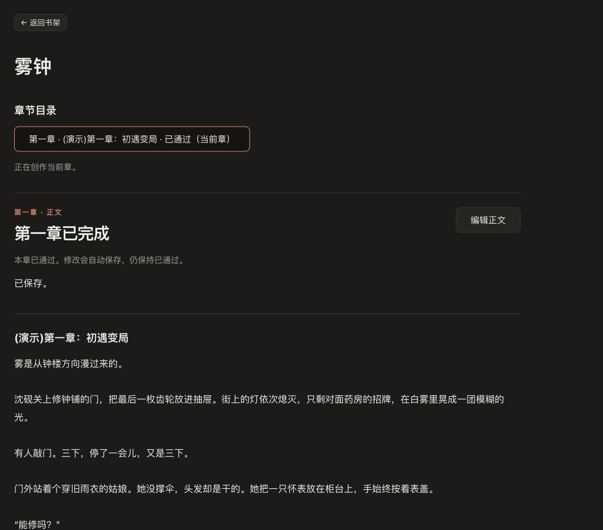

<h1 align="center">
  
</h1>

<p align="center">
  
  
  
  
  <a href="./LICENSE"></a>
</p>

<p align="center">
  <a href="#当前状态">✦ 项目简介</a> ·
  <a href="#快速开始">→ 快速开始</a> ·
  <a href="#文档">⌘ 文档</a> ·
  <a href="./README.en.md">English</a>
</p>

**从一句脑洞，到一章正文。** 输入故事想法，或导入 TXT、Markdown（`.md`）、Word（`.docx`）、PDF 文档中的文字。AI 帮你选择故事方向、规划大纲、补充设定并逐章写作；你负责修改内容、把关方向和推进下一章。



<a id="当前状态"></a>

## ✦ 项目简介

**agent4novel 是一个本机运行的中文 AI 写作工具，通过浏览器使用。** 本机最小可用版本（MVP）已交付，项目持续开发中。

<a id="主要功能"></a>

## ◆ 主要功能

- **输入与创作**：从脑洞或文档开始，完成创意稿、大纲、设定、章纲和正文。
- **审阅与续写**：逐章审阅、编辑和重写；保留历史版本，由你决定何时开始下一章。
- **写作配置**：设置文风、题材、爽点、模型和生成参数，也可上传 Prompt 与 Skill 指导文件。
- **坏例收集**：标记正文选段并添加备注，保留当时原文与版本供回看。
- **本地保存**：作品、产物版本、配置和上传文件保存在本机，支持重启恢复与备份。

<a id="快速开始"></a>

## → 快速开始

### Docker（推荐）

```bash
git clone https://github.com/12bitsD/agent4novel.git
cd agent4novel
docker compose up --build -d --wait
```

打开 **[localhost:8787](http://localhost:8787)**。停止服务使用 `docker compose stop`。

<details>
<summary>从源码启动</summary>

需要 **Node.js 24.19.0、pnpm 12.5.1**，适用于 macOS 和 Linux：

```bash
git clone https://github.com/12bitsD/agent4novel.git
cd agent4novel
pnpm install --frozen-lockfile
pnpm dev
```

保持终端运行，打开 **[localhost:5173](http://localhost:5173)**。

</details>

未配置 API key 时会使用内置示例，不调用 AI。真实模型支持 **DeepSeek、LongCat 和 Kimi**，配置方法见 [模型配置说明](./docs/wiki/016-model-runtime-provider-config.md)。

<a id="数据与限制"></a>

## ▣ 数据与限制

- Docker 数据保存在 Compose 的 `data` 数据卷；源码运行默认保存在 `.data/`。
- 当前面向本机单用户，没有账号与公网访问控制。
- 整本小说的生成质量尚未完成评估，工程验收范围见 [MVP 验证记录](./docs/wiki/001-mvp-acceptance.md#测试与验证)。

<a id="文档"></a>

## ⌘ 文档

- [模型配置](./docs/wiki/016-model-runtime-provider-config.md) · [CLI 说明](./docs/wiki/014-agent-cli-telemetry.md)
- [项目 Wiki](./docs/wiki/README.md) · [工程交接](./docs/handoff.md)
- [Issues](https://github.com/12bitsD/agent4novel/issues) · [第二期路线计划](./docs/plans/mvp-phase2-roadmap.md)

<sub>界面截图与正文均为演示素材，不代表真实模型生成效果；首屏使用项目书页矢量标志。</sub>

---

[反馈问题或建议](https://github.com/12bitsD/agent4novel/issues) · [MIT 开源许可](./LICENSE)
